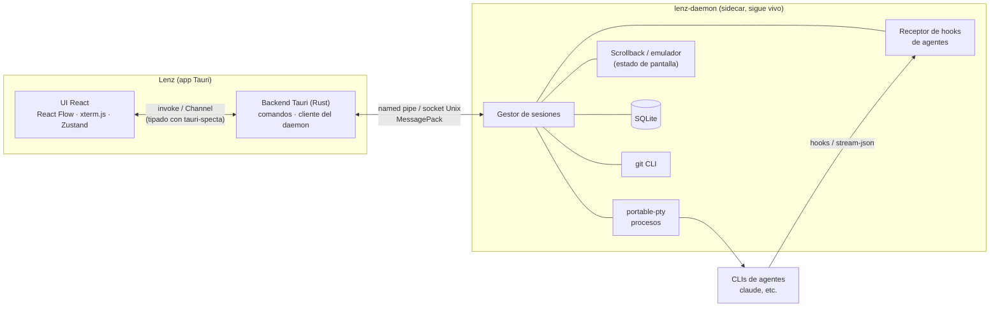

# Lenz — Tecnologías y arquitectura

> Documento base para la reescritura de Lenz desde cero.
> Plataformas objetivo: **Windows y macOS**.
> Última actualización: 2026-11-12.

---

## Índice

1. [Qué es Lenz](#1-qué-es-lenz)
2. [Principios de diseño](#2-principios-de-diseño)
3. [Stack tecnológico](#3-stack-tecnológico)
4. [Arquitectura general](#4-arquitectura-general)
5. [El daemon (`lenz-daemon`)](#5-el-daemon-lenz-daemon)
6. [La app de escritorio (Tauri + React)](#6-la-app-de-escritorio-tauri--react)
7. [El lienzo (React Flow)](#7-el-lienzo-react-flow)
8. [Terminales (xterm.js)](#8-terminales-xtermjs)
9. [Integración con agentes de IA](#9-integración-con-agentes-de-ia)
10. [Git, worktrees y revisión de cambios](#10-git-worktrees-y-revisión-de-cambios)
11. [Persistencia](#11-persistencia)
12. [Arte ASCII y estética](#12-arte-ascii-y-estética)
13. [Estructura del repositorio](#13-estructura-del-repositorio)
14. [Herramientas de desarrollo y calidad](#14-herramientas-de-desarrollo-y-calidad)
15. [CI, empaquetado y distribución](#15-ci-empaquetado-y-distribución)
16. [Trabajo en equipo](#16-trabajo-en-equipo)
17. [Riesgos conocidos y mitigaciones](#17-riesgos-conocidos-y-mitigaciones)
18. [Hoja de ruta inicial](#18-hoja-de-ruta-inicial)

---

## 1. Qué es Lenz

Lenz es una app de escritorio para orquestar agentes de IA de línea de comandos (Claude Code y otros CLIs) sobre un **lienzo infinito**. En el lienzo se colocan terminales, notas, diffs y otros elementos. Cada agente corre en su propia terminal y, opcionalmente, en su propio _git worktree_.

Requisitos clave:

- **Las terminales sobreviven al cierre de la app.** Al reabrir Lenz, cada agente sigue corriendo y su pantalla aparece tal como estaba.
- **Lienzo como interfaz principal**, no pestañas.
- **Liviana y nativa** en Windows y macOS.
- **Estética terminal / ASCII** cuidada.

---

## 2. Principios de diseño

1. **La verdad vive en el daemon.** Los procesos, el estado de las pantallas y los datos persistentes viven en `lenz-daemon`. La UI es una proyección que se puede cerrar y reabrir sin perder nada.
2. **Contratos tipados.** Todo mensaje entre Rust y TypeScript tiene tipos generados automáticamente. Nadie rompe al otro sin enterarse.
3. **Rendimiento por diseño.** Solo se renderiza "en vivo" lo que el usuario está mirando.
4. **Eventos estructurados antes que parsear texto.** Para saber qué hace un agente se usan hooks o salida JSON del CLI, no expresiones regulares sobre la terminal.
5. **Multiplataforma desde el día 1.** El CI compila y prueba en Windows y macOS en cada PR.

---

## 3. Stack tecnológico

### 3.1 Core (Rust)

| Área               | Tecnología                             | Por qué                                                                                                                     |
| ------------------ | -------------------------------------- | --------------------------------------------------------------------------------------------------------------------------- |
| Shell de la app    | **Tauri 2**                            | Binarios pequeños, usa el WebView del sistema y tiene un backend en Rust                                                    |
| Runtime async      | **tokio**                              | Estándar de facto para I/O concurrente                                                                                      |
| Motor de terminal  | **portable-pty**                       | El motor de WezTerm; soporta ConPTY en Windows y PTY en macOS                                                               |
| Estado de pantalla | **alacritty_terminal** (o `vt100`)     | El daemon emula la terminal y guarda la pantalla actual, que se usa al reconectar y para las vistas previas del lienzo      |
| IPC app ↔ daemon   | **tokio** (named pipes / `UnixStream`) | Transporte nativo de cada sistema sin dependencias extra; el código está en `lenz-protocol::transport` y `lenz-daemon::ipc` |
| Serialización      | **serde + rmp-serde** (MessagePack)    | Binario, compacto y rápido para flujos de salida de terminal                                                                |
| Persistencia       | **rusqlite** (SQLite)                  | Un solo archivo, transaccional y sin servidor                                                                               |
| Git                | **CLI de `git`** invocado desde Rust   | Soporte completo y fiel de worktrees y diffs; más simple que `git2`                                                         |
| Tipos Rust → TS    | **tauri-specta**                       | Genera bindings TypeScript de los comandos y eventos de Tauri                                                               |
| Errores / logs     | **thiserror**, **anyhow**, **tracing** | Errores tipados y logs estructurados                                                                                        |

### 3.2 Interfaz (TypeScript)

| Área               | Tecnología                                                                   | Por qué                                                        |
| ------------------ | ---------------------------------------------------------------------------- | -------------------------------------------------------------- |
| Framework          | **React 19 + TypeScript**                                                    | Ecosistema y familiaridad                                      |
| Bundler            | **Vite**                                                                     | Arranque y HMR instantáneos; integración oficial con Tauri     |
| Lienzo             | **@xyflow/react** (React Flow 12)                                            | Nodos personalizados, zoom, paneo y minimapa listos para usar  |
| Terminal           | **@xterm/xterm** + addons `webgl`, `fit`, `search`, `web-links`, `unicode11` | El estándar de terminales web (lo usa VS Code)                 |
| Estado de UI       | **Zustand**                                                                  | Mínimo, sin boilerplate y con selectores finos                 |
| Estilos            | **Tailwind CSS v4**                                                          | Utilidades y tokens de diseño en CSS                           |
| Componentes        | **shadcn/ui** (sobre Radix)                                                  | Accesibles y con el código en el repo, fáciles de personalizar |
| Animaciones        | **Motion** (ex Framer Motion)                                                | Transiciones del lienzo, boot screen y aparición de nodos      |
| Paleta de comandos | **cmdk**                                                                     | `Ctrl/Cmd+K` para todo                                         |
| Notificaciones     | **Sonner**                                                                   | Toasts                                                         |
| Íconos             | **Lucide**                                                                   | Consistentes y livianos                                        |
| Diffs              | **Monaco diff editor** (versión liviana) o **react-diff-view**               | Revisión de cambios de los agentes                             |
| ASCII              | **figlet** + arte propio                                                     | Títulos y decoración                                           |
| Fuente             | **Geist Mono** (fuente de la marca), incluida en la app                      | Mismo resultado en todos los sistemas                          |

### 3.3 Herramientas

| Área                          | Tecnología                                     |
| ----------------------------- | ---------------------------------------------- |
| Gestor de paquetes / monorepo | **pnpm workspaces** + **Cargo workspace**      |
| Lint y formato TS             | **Biome**                                      |
| Lint y formato Rust           | **clippy** + **rustfmt**                       |
| Tests                         | **Vitest** (TS), **cargo test** (Rust)         |
| CI / releases                 | **GitHub Actions** + **tauri-action**          |
| Auto-update                   | **tauri-plugin-updater** sobre GitHub Releases |

---

## 4. Arquitectura general



**Flujo típico:**

1. El usuario crea un nodo terminal en el lienzo.
2. La UI llama a un comando Tauri, el backend se lo pide al daemon y el daemon crea el PTY y lanza el CLI.
3. La salida del PTY va al emulador del daemon (que actualiza la pantalla) y, si hay una UI suscrita, viaja por el pipe hasta un `Channel` de Tauri y de ahí a xterm.js.
4. El usuario cierra Lenz. El daemon y los procesos siguen vivos.
5. El usuario reabre Lenz. La app se reconecta al daemon, recibe el layout del lienzo y la pantalla actual de cada terminal, y todo vuelve a verse igual.

---

## 5. El daemon (`lenz-daemon`)

Binario Rust independiente, empaquetado como **sidecar** de Tauri (`externalBin`).

### 5.1 Responsabilidades

- Crear, redimensionar y cerrar PTYs (`portable-pty`).
- Emular cada terminal (`alacritty_terminal`) para conservar la pantalla y un scrollback acotado.
- Atender múltiples clientes: la app, y en el futuro un CLI `lenz`.
- Persistir proyectos, layout del lienzo, agentes y configuración (SQLite).
- Ejecutar operaciones git (worktrees, diffs, estado).
- Recibir eventos de agentes (hooks) y publicar cambios de estado.

### 5.2 Ciclo de vida

| Evento                         | Comportamiento                                                                                                               |
| ------------------------------ | ---------------------------------------------------------------------------------------------------------------------------- |
| La app arranca                 | Intenta conectarse al pipe o socket. Si no hay daemon, lo lanza y espera a que esté listo                                    |
| La app se cierra               | El daemon sigue corriendo                                                                                                    |
| No quedan sesiones ni clientes | El daemon se cierra solo tras un tiempo de inactividad configurable                                                          |
| Actualización de la app        | La app avisa al daemon, que cierra limpio; al reabrir se lanza la versión nueva. Hay versionado de protocolo en el handshake |

**Detalles por sistema:**

- **Windows:** lanzar con `DETACHED_PROCESS` y `CREATE_BREAKAWAY_FROM_JOB` para que no muera con la app. Usar un named pipe como `\\.\pipe\lenz-<usuario>`.
- **macOS:** lanzar con `setsid` (nueva sesión) y usar un socket Unix en `~/Library/Application Support/Lenz/daemon.sock`.

### 5.3 Protocolo (`lenz-protocol`)

- Crate compartido que define `Request`, `Response` y `Event` con `serde`.
- Frames: longitud (u32) + payload MessagePack.
- **Handshake** con versión de protocolo; si no coincide, la app reinicia el daemon.
- La salida de terminal viaja como `Event::Output { session_id, bytes }`, **agrupada cada ~16 ms**, para no saturar la UI.

---

## 6. La app de escritorio (Tauri + React)

### 6.1 Backend Tauri (`apps/desktop/src-tauri`)

- Cliente del daemon: conexión, reconexión y handshake.
- Comandos Tauri finos que delegan al daemon (`create_session`, `write_input`, `resize`, `list_projects`…).
- Salida de terminales hacia la UI mediante **`tauri::ipc::Channel`** (binario, ordenado y eficiente), nunca con eventos JSON genéricos.
- Bindings TypeScript generados con **tauri-specta** en `apps/desktop/src/bindings.ts`.

### 6.2 Frontend (`apps/desktop/src`)

Organización por _features_:

```
src/
├─ app/            # arranque, providers, layout raíz, rutas
├─ canvas/         # lienzo React Flow, tipos de nodo, controles
├─ terminal/       # wrapper de xterm.js, pool de renderers, vista previa
├─ agents/         # creación de agentes, estados, squads
├─ review/         # diffs y comentarios de revisión
├─ settings/       # ajustes y proveedores
├─ ascii/          # arte ASCII, figlet, boot screen
├─ components/ui/  # shadcn/ui
├─ stores/         # stores Zustand
├─ lib/            # utilidades, cliente de bindings
└─ bindings.ts     # generado por tauri-specta (no editar)
```

### 6.3 Estado (Zustand)

- **El estado de la UI** (selección, zoom, paneles abiertos, nodo enfocado) vive en Zustand.
- **El estado del dominio** (sesiones, agentes, layout) lo emite el daemon. Zustand guarda una copia que se actualiza con eventos y nunca es la fuente de la verdad.
- Un store por dominio (`canvasStore`, `sessionsStore`, `agentsStore`, `settingsStore`), con selectores finos para evitar re-renders del lienzo.

---

## 7. El lienzo (React Flow)

El lienzo es la interfaz principal y lo que diferencia a Lenz.

### 7.1 Tipos de nodo

| Tipo       | Contenido                              |
| ---------- | -------------------------------------- |
| `terminal` | Una sesión del daemon (shell o agente) |
| `note`     | Nota en Markdown                       |
| `diff`     | Cambios de un worktree / agente        |
| `ascii`    | Arte ASCII decorativo o banner         |
| `group`    | Agrupa nodos; un _squad_ es un grupo   |

Agregar un tipo nuevo consiste en crear un componente, registrarlo en `nodeTypes` y definir su esquema de persistencia.

### 7.2 Reglas de rendimiento

- **Terminal viva solo cuando importa.** xterm.js con WebGL solo se monta en los nodos **visibles en el viewport** y con **zoom ≥ umbral** (p. ej. 0.75), con un máximo de ~8 renderers WebGL simultáneos (pool LRU).
- **Vista previa para el resto.** Los demás nodos terminal muestran un `<pre>` con la pantalla actual que provee el daemon, actualizado con poca frecuencia. Alejado, el lienzo se ve como un mosaico de arte ASCII vivo.
- **Foco y zoom.** Doble clic en un nodo anima el viewport hasta zoom 1.0 centrado en él, o lo abre a pantalla completa. Nunca se escribe en una terminal escalada.
- **Interacción.** Las clases `nodrag nowheel nopan` dentro de la terminal permiten scroll y selección sin mover el lienzo.
- Componentes de nodo memoizados y selectores Zustand por id de nodo.

### 7.3 Persistencia del lienzo

Posición, tamaño, tipo y datos de cada nodo se guardan en SQLite (vía daemon) con _debounce_. Al reabrir, el lienzo se restaura exacto.

---

## 8. Terminales (xterm.js)

- Paquete `@xterm/xterm` con addons:
  - `webgl`: renderizado rápido (solo en terminales vivas).
  - `fit`: ajuste al tamaño del nodo, que dispara `resize` hacia el PTY.
  - `search`, `web-links`, `unicode11`.
- **Reconexión:** al montar, se pide al daemon la pantalla actual serializada, se escribe en xterm y luego se suscribe al flujo en vivo.
- **Entrada:** `onData` → comando `write_input` → daemon → PTY.
- **Tema:** colores derivados de los tokens de diseño de la app, en modo claro y oscuro.
- **Diferencias de WebView:** WebView2 (Windows) y WKWebView (macOS) se comportan distinto. Hay que probar en ambos el renderizado, las fuentes y los atajos de teclado (`Cmd` vs `Ctrl`).

---

## 9. Integración con agentes de IA

Lenz **no reimplementa la IA**: lanza los CLIs oficiales de los agentes dentro de PTYs.

### 9.1 Proveedores

- **Claude Code** (primero), y luego otros CLIs compatibles.
- Configuración por proveedor en Ajustes: comando, argumentos, variables de entorno y directorio.

### 9.2 Detección de estado

Estados: `iniciando` · `trabajando` · `esperando input` · `terminado` · `error`.

| Fuente                                                                     | Prioridad          | Notas                                                                  |
| -------------------------------------------------------------------------- | ------------------ | ---------------------------------------------------------------------- |
| **Hooks del CLI** (p. ej. hooks de Claude Code)                            | 1                  | El agente notifica eventos estructurados al daemon (HTTP local o pipe) |
| **Salida estructurada** (`--output-format stream-json` u otra equivalente) | 2                  | Para modos no interactivos                                             |
| Heurística sobre la salida de la terminal                                  | 3 (último recurso) | Frágil: se rompe con cada actualización del CLI                        |

Al lanzar un agente, el daemon configura los hooks para que apunten a sí mismo, con la sesión identificada por variable de entorno.

### 9.3 Atención del usuario

Cuando un agente pasa a "esperando input", el nodo se resalta en el lienzo, aparece un badge en la paleta y se envía una notificación del sistema si la ventana no tiene foco.

---

## 10. Git, worktrees y revisión de cambios

- Toda operación git se hace invocando el **CLI de `git`** desde el daemon.
- **Una tarea = un worktree** (opcional): el agente trabaja aislado en `<repo>/.lenz/worktrees/<tarea>` o en un directorio configurable, en su propia rama.
- **Revisión:** nodo `diff` o panel lateral con el diff del worktree contra su rama base, comentarios por línea que se pueden devolver al agente, y acciones para aceptar (merge) o descartar.

---

## 11. Persistencia

**SQLite**, administrado exclusivamente por el daemon.

| Ubicación                                    | Sistema |
| -------------------------------------------- | ------- |
| `%APPDATA%\Lenz\lenz.db`                     | Windows |
| `~/Library/Application Support/Lenz/lenz.db` | macOS   |

Tablas iniciales (orientativas): `projects`, `canvas_nodes`, `sessions`, `agents`, `providers`, `settings`, `review_comments`.

Migraciones versionadas en `crates/lenz-daemon/migrations/`.

---

## 12. Arte ASCII y estética

El arte ASCII es parte de la identidad de Lenz.

### 12.1 Usos

- **Boot screen** animado al abrir la app (logo de `lenz-brand` en ASCII, con Motion).
- **Estados vacíos:** "sin agentes todavía", "proyecto vacío"…, con ilustraciones ASCII.
- **Banner de bienvenida** dentro de cada terminal nueva.
- **Títulos** de secciones generados con `figlet`.
- **Nodos `ascii`** decorativos en el lienzo.
- Las vistas previas de terminales en el lienzo alejado refuerzan esa estética.

### 12.2 Reglas técnicas

- **Fuente monoespaciada incluida en la app** (Geist Mono, la fuente de la marca). Nunca depender de fuentes del sistema: un carácter de ancho distinto descuadra el arte.
- Renderizar en `<pre>` con `line-height` y `letter-spacing` fijos.
- Verificar que la fuente incluya los **caracteres de caja** (`┌─┐│└┘╭╮╯╰`) y de **bloques** (`░▒▓█▀▄`).
- `aria-hidden="true"` en el arte decorativo, con texto alternativo cuando aporte significado.
- Respetar `prefers-reduced-motion` en las animaciones.
- Guardar el arte como archivos `.txt` en `apps/desktop/src/ascii/art/`, no como strings sueltos en el código.

---

## 13. Estructura del repositorio

```
lenz/
├─ apps/
│  └─ desktop/                    # App Tauri
│     ├─ src/                     # Frontend React (ver §6.2)
│     ├─ src-tauri/
│     │  ├─ src/                  # Backend Tauri: cliente del daemon, comandos
│     │  ├─ binaries/             # Sidecar lenz-daemon (generado en build)
│     │  ├─ icons/
│     │  ├─ capabilities/         # Permisos de Tauri 2
│     │  ├─ Cargo.toml
│     │  └─ tauri.conf.json
│     ├─ index.html
│     ├─ package.json
│     └─ vite.config.ts
├─ crates/
│  ├─ lenz-daemon/                # Sidecar: PTYs, emulador, SQLite, git, hooks
│  │  ├─ src/
│  │  ├─ migrations/
│  │  └─ Cargo.toml
│  └─ lenz-protocol/              # Tipos de mensajes app ↔ daemon
│     ├─ src/
│     └─ Cargo.toml
├─ lenz-brand/                    # Logos, colores, assets de marca
├─ docs/                          # Documentación adicional, ADRs
├─ .github/
│  └─ workflows/
│     ├─ ci.yml                   # Lint + tests + build en Windows y macOS
│     └─ release.yml              # tauri-action al hacer push de tag v*
├─ Cargo.toml                     # Cargo workspace
├─ package.json                   # pnpm workspace (scripts raíz)
├─ pnpm-workspace.yaml
├─ biome.json
├─ rust-toolchain.toml
├─ .editorconfig
├─ .gitattributes
├─ .gitignore
├─ ARQUITECTURA.md                # Este documento
└─ README.md
```

---

## 14. Herramientas de desarrollo y calidad

### 14.1 Requisitos locales

- Rust estable (fijado en `rust-toolchain.toml`)
- Node.js LTS + pnpm
- Windows: WebView2 (viene con Windows 11) y Visual Studio Build Tools (C++)
- macOS: Xcode Command Line Tools

### 14.2 Scripts raíz (propuestos)

| Script          | Acción                                               |
| --------------- | ---------------------------------------------------- |
| `pnpm dev`      | Compila el daemon y levanta Tauri en modo desarrollo |
| `pnpm build`    | Build de producción local                            |
| `pnpm lint`     | Biome + clippy                                       |
| `pnpm format`   | Biome + rustfmt                                      |
| `pnpm test`     | Vitest + cargo test                                  |
| `pnpm bindings` | Regenera `bindings.ts` con tauri-specta              |

### 14.3 Convenciones

- **Commits:** Conventional Commits (`feat:`, `fix:`, `chore:`…).
- **Ramas:** `main` protegida; trabajo en `feat/<tema>` con PR y CI en verde.
- **Decisiones de arquitectura:** documentadas como ADRs breves en `docs/adr/`.

---

## 15. CI, empaquetado y distribución

### 15.1 CI (`ci.yml`)

En cada PR, matriz con `windows-latest` y `macos-latest`: lint, tests y build de verificación.

### 15.2 Releases (`release.yml`)

Al hacer push de un tag `v*`, **tauri-action** compila en runners de GitHub y publica un borrador en GitHub Releases:

- Windows: `.msi` / `.exe` (NSIS)
- macOS: `.dmg` (universal: Apple Silicon + Intel)

**No se necesita una Mac para compilar:** el runner `macos-latest` lo hace.

### 15.3 Firma: fase inicial sin costo

| Sistema     | Configuración                                                                                                                                               | Experiencia del usuario                                                                                                                                  |
| ----------- | ----------------------------------------------------------------------------------------------------------------------------------------------------------- | -------------------------------------------------------------------------------------------------------------------------------------------------------- |
| **Windows** | Sin firmar                                                                                                                                                  | SmartScreen avisa una vez: "Más información" → "Ejecutar de todas formas"                                                                                |
| **macOS**   | **Firma ad-hoc**: `"signingIdentity": "-"` en `tauri.conf.json`. Gratis y sin cuenta de Apple. **Obligatoria**: sin ella la app no arranca en Apple Silicon | Gatekeeper la bloquea la primera vez. Se resuelve con `xattr -cr /Applications/Lenz.app` o en Ajustes → Privacidad y seguridad → "Abrir de todas formas" |

- Las apps **compiladas localmente** no tienen esta advertencia (solo afecta a descargas).
- El **auto-updater** usa llaves propias de Tauri (`pnpm tauri signer generate`), gratuitas e independientes de Apple. La llave privada va en los _secrets_ de GitHub.

### 15.4 Firma: fase pública (más adelante)

- macOS: Apple Developer Program (99 USD/año), firma Developer ID + notarización en tauri-action.
- Windows: Azure Trusted Signing (~10 USD/mes) o un certificado OV/EV.

---

## 16. Trabajo en equipo

División natural en dos frentes que se encuentran en un contrato tipado:

| Frente              | Alcance                                                                |
| ------------------- | ---------------------------------------------------------------------- |
| **Core (Rust)**     | `crates/lenz-daemon`, `crates/lenz-protocol`, `apps/desktop/src-tauri` |
| **UI (TypeScript)** | `apps/desktop/src`: lienzo, terminales, UI, ASCII                      |

- El **contrato** son `lenz-protocol` y los comandos Tauri, con tipos generados por **tauri-specta**. Cambiarlo requiere PR revisado por ambos.
- El frente UI puede avanzar con un **mock del daemon** mientras el core no está listo.

---

## 17. Riesgos conocidos y mitigaciones

| Riesgo                                               | Mitigación                                                                    |
| ---------------------------------------------------- | ----------------------------------------------------------------------------- |
| Límite de ~16 contextos WebGL con muchas terminales  | Pool de renderers WebGL (máx. ~8) y vista previa `<pre>` para el resto (§7.2) |
| Terminal borrosa o selección descuadrada con zoom    | Escribir solo a zoom 1.0; foco con animación o pantalla completa (§7.2)       |
| UI trabada por la salida masiva de los PTYs          | Agrupar cada ~16 ms, MessagePack y `tauri::ipc::Channel` binario (§5.3, §6.1) |
| Procesos que mueren al cerrar la app                 | Daemon sidecar desacoplado del proceso de la app (§5.2)                       |
| Diferencias entre WebView2 y WKWebView               | CI en ambos sistemas; probar fuentes y atajos de teclado desde el inicio      |
| Detección frágil del estado de los agentes           | Hooks y salida estructurada primero; heurística como último recurso (§9.2)    |
| Incompatibilidad app ↔ daemon tras una actualización | Versión de protocolo en el handshake; reinicio controlado del daemon (§5.2)   |
| Curva de aprendizaje de Rust                         | División por frentes y contrato tipado (§16)                                  |
| Fricción de instalación sin firmar                   | Instrucciones claras en el README; firmar en la fase pública (§15)            |

---

## 18. Hoja de ruta inicial

| Fase                     | Entregable                                                                                                                 |
| ------------------------ | -------------------------------------------------------------------------------------------------------------------------- |
| **0. Esqueleto**         | Monorepo, Tauri corriendo, CI en Windows y macOS, release con tauri-action                                                 |
| **1. Daemon + terminal** | ✅ Hecha. El daemon abre un PTY; un nodo de React Flow muestra la terminal; la sesión sobrevive al cerrar y reabrir la app |
| **2. Lienzo**            | Tipos de nodo, persistencia del layout, foco/zoom, pool de renderers y vistas previas                                      |
| **3. Agentes**           | Proveedores, lanzamiento de agentes, estados por hooks, squads como grupos                                                 |
| **4. Worktrees**         | Una tarea = un worktree, gestionado desde el lienzo                                                                        |
| **5. Revisión**          | Nodo diff, comentarios por línea y aceptar/descartar                                                                       |
| **6. Pulido**            | Arte ASCII, boot screen, paleta de comandos, auto-updater                                                                  |
