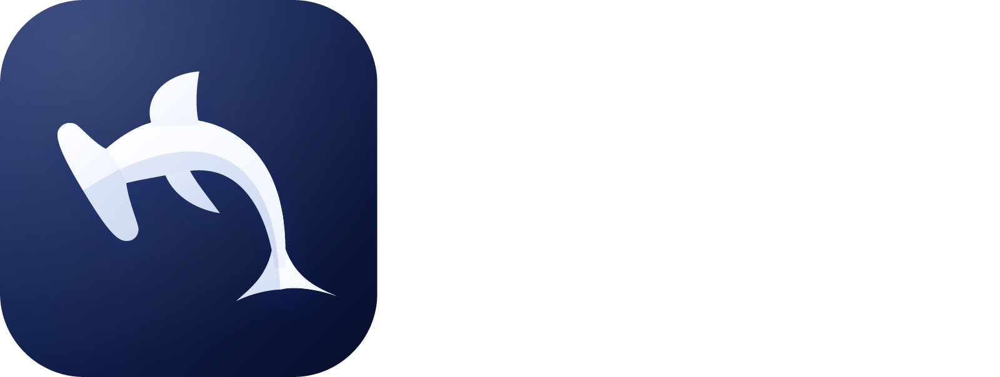

<p align="center">
  
</p>

<p align="center"><strong>El sexto sentido de tu código.</strong><br/>ADE de escritorio para lanzar y orquestar squads de agentes de IA.</p>

## Requisitos

- Node.js 22 o superior
- pnpm (`npm install -g pnpm`)
- Windows 10+ o macOS

## Desarrollo

```sh
pnpm install
pnpm dev          # abre Lenz con recarga en caliente
```

| Comando                                | Qué hace                                          |
| -------------------------------------- | ------------------------------------------------- |
| `pnpm lint`                            | Lint y formato (Biome)                            |
| `pnpm format`                          | Formatea todo                                     |
| `pnpm typecheck`                       | Revisa tipos                                      |
| `pnpm test`                            | Pruebas (incluye el daemon con terminales reales) |
| `pnpm build`                           | Compila a `apps/desktop/out`                      |
| `pnpm --filter @lenz/desktop dist:win` | Instalador `.exe` en `apps/desktop/release/`      |
| `pnpm --filter @lenz/desktop dist:mac` | `.dmg` (hay que correrlo en una Mac)              |

El CI (GitHub Actions) genera el `.exe` y el `.dmg` en cada push a `main`; se descargan desde los _artifacts_ del workflow.

> **Mac:** la app no está firmada. La primera vez ábrela con clic derecho → Abrir.
> **Windows:** SmartScreen avisa porque no hay certificado; "Más información" → "Ejecutar de todas formas".

## Agentes

**Nuevo agente** (`+` en _Squad_, o Ctrl+Shift+A / ⇧⌘A) lanza Claude Code en el proyecto activo, con una tarea opcional. La barra lateral muestra a cada agente: **Trabajando**, **Te necesita** (pide permiso o tiene una pregunta), **Listo** (terminó y aún no lo miras), **Inactivo** o **Error**. Si un agente te necesita o termina mientras miras otra cosa, llega una notificación del sistema. Si reinicias el PC, al abrir Lenz cada agente retoma su conversación.

**Ajustes → Proveedores** (⚙ abajo en la barra lateral, o Ctrl+, / ⌘,):

- _Claude (suscripción)_: usa tu sesión de `claude`. Requiere [Claude Code](https://claude.com/claude-code) instalado.
- _z.ai (GLM)_: pega tu API key de z.ai.
- _Personalizado_: cualquier API compatible con Anthropic (`/v1/messages`). Para **NVIDIA**, corre un traductor local (por ejemplo LiteLLM) y apunta el perfil a él.

Las API keys se guardan cifradas por el sistema operativo.

## Atajos

| Acción                       | Windows                                       | Mac      |
| ---------------------------- | --------------------------------------------- | -------- |
| Nueva pestaña                | Ctrl+Shift+T                                  | ⌘T       |
| Nuevo agente                 | Ctrl+Shift+A                                  | ⇧⌘A      |
| Dividir a la derecha         | Ctrl+Shift+D                                  | ⌘D       |
| Dividir hacia abajo          | Ctrl+Shift+E                                  | ⇧⌘D      |
| Cerrar panel                 | Ctrl+Shift+W                                  | ⌘W       |
| Siguiente / anterior pestaña | Ctrl+Tab / Ctrl+Shift+Tab                     | ⌃⇥ / ⌃⇧⇥ |
| Ajustes                      | Ctrl+,                                        | ⌘,       |
| Copiar                       | Ctrl+C con texto seleccionado, o Ctrl+Shift+C | ⌘C       |
| Pegar                        | Ctrl+V o Ctrl+Shift+V                         | ⌘V       |

## Estructura

```
apps/desktop/        App Electron (main, preload, renderer React)
packages/daemon/     lenzd: mantiene vivas las terminales aunque cierres Lenz
packages/protocol/   Mensajes, endpoint y cliente de lenzd
lenz-brand/          Kit de marca
docs/                Análisis y plan
```

Cerrar la ventana **no** cierra las terminales: siguen corriendo en `lenzd` y Lenz las recupera al abrirse. `lenzd` se apaga solo cuando no quedan terminales.
Logs: `logs/` dentro de la carpeta de datos (`%APPDATA%\Lenz` en Windows, `~/Library/Application Support/Lenz` en Mac; en desarrollo, `Lenz Dev`).

Plan y fases: [docs/02-plan.md](docs/02-plan.md).
